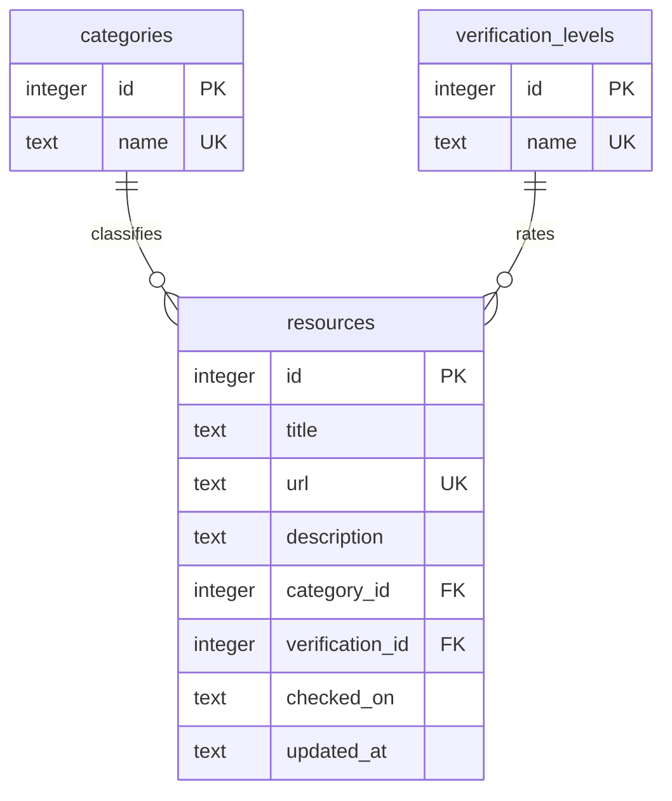

# OpenDB 오픈소스 자료 카탈로그

프로젝트에 활용할 오픈소스와 웹서비스의 출처, 분류, 검증 수준과 활용 메모를 관리하는 웹 응용시스템입니다. [agentflow-open](https://github.com/laadkke-arch/agentflow-open)의 조사 기록 원칙을 참고했습니다.

[공개 웹서비스](https://opendb-tlsee0813.onrender.com)

## 기능

- 자료명·출처 URL·활용 메모로 검색하고, 분류와 검증 수준으로 결과를 좁힙니다.
- 상세 화면에서 출처와 확인일을 확인합니다.
- 자료를 추가하고, 기존 자료를 수정하고, 확인 화면을 거쳐 삭제합니다.
- 새 데이터베이스에서 4개 분류, 3개 검증 수준, 12개 자료로 시작합니다.

## 로컬 실행

Python 3.12에서 실행합니다.

```sh
python -m venv .venv
source .venv/bin/activate
pip install -r requirements.txt
flask --app app run
```

[http://127.0.0.1:5000](http://127.0.0.1:5000)에 접속합니다. Turso 환경 변수가 비어 있으면 `instance/opendb.sqlite3`에 저장합니다. Windows PowerShell에서는 `.venv\Scripts\Activate.ps1`로 가상 환경을 활성화합니다.

## Turso Cloud 연결 및 Render 배포

1. [Turso](https://app.turso.tech/)에서 과제용 빈 **libSQL** DB를 만들고 URL과 읽기·쓰기 DB 토큰을 발급합니다.
2. Render에서 이 저장소의 `main`을 소스로 Python 웹서비스를 생성합니다. 빌드 명령은 `pip install -r requirements.txt`, 시작 명령은 `gunicorn --workers 1 --threads 4 --bind 0.0.0.0:$PORT 'app:create_app()'`입니다.
3. Render의 **Environment**에 다음 변수를 설정하고 배포합니다.

| 환경 변수 | 값 |
| --- | --- |
| `TURSO_DATABASE_URL` | Turso의 DB 연결 주소 |
| `TURSO_AUTH_TOKEN` | 해당 DB의 읽기·쓰기 토큰 |
| `FLASK_SECRET_KEY` | 세션 서명용 임의 값. 로컬에서 `python -c "import secrets; print(secrets.token_hex(32))"`로 생성 |
| `OPENDB_HOSTED` | `1` |
| `GUNICORN_CMD_ARGS` | `--access-logfile -` |

Gunicorn에서 미리 로드 옵션을 제외해 libSQL 원격 연결을 워커 프로세스에서 초기화합니다. 앱이 시작할 때 `db/schema.sql`과 `db/seed.sql`을 적용합니다. 앱 테이블 존재 여부를 확인하고 초기 스키마와 샘플을 한 트랜잭션에서 생성합니다. 재시작 시 기존 데이터가 유지됩니다. `/healthz`가 HTTP 200과 `"database":"turso"`를 반환하면 앱이 Turso로 연결된 상태입니다. 두 DB 변수를 모두 생략해 Render에서 실행한 경우 SQLite 데이터는 인스턴스 교체 시 초기화될 수 있습니다.

## 데이터베이스 설계



자료는 분류 하나와 검증 수준 하나에 속합니다. 참조 중인 분류 또는 검증 수준 삭제는 DB에서 제한합니다. 각 칼럼은 원자값을 저장하고, 단일 열 PK를 사용하며, 분류명과 검증 수준명은 각각의 참조 테이블에만 저장합니다. 이 설계에서 채택한 업무 규칙을 기준으로 3NF를 충족합니다. 동일 URL은 하나의 자료로 관리합니다.

자료 목록 조회는 두 참조 테이블을 `JOIN`하고 검색어 및 필터를 바인딩합니다. 쓰기는 `INSERT`, `UPDATE`, `DELETE`와 `RETURNING id`를 사용합니다. 삭제 확인 폼은 POST로 처리합니다.

## Antigravity 2.0 검토 재현

초기 구현에는 Codex를 사용했습니다. 과제에서 지정한 Antigravity 2.0의 실제 검토 이력을 남기려면, 해당 앱에서 이 저장소를 열고 다음과 같이 요청한 뒤 실행 결과와 적용한 변경 사항을 보고서에 기록합니다.

> db/schema.sql을 읽고 PK·FK, 1:N, 3NF가 실제 데이터 규칙과 일치하는지 검토해 줘. Flask 앱을 로컬에서 실행하고 이름 검색, 자료 추가, 수정, 삭제 취소와 삭제 확인을 순서대로 재현해 줘. 수정할 문제가 있으면 원인과 변경 diff를 보여 줘. 비밀 값과 클라우드 설정에는 접근하지 마.

## 참고 자료

- [Turso Python SDK 원격 연결](https://github.com/tursodatabase/turso-docs/blob/main/sdk/python/quickstart.mdx)
- [Render 웹 서비스](https://render.com/docs/web-services)
