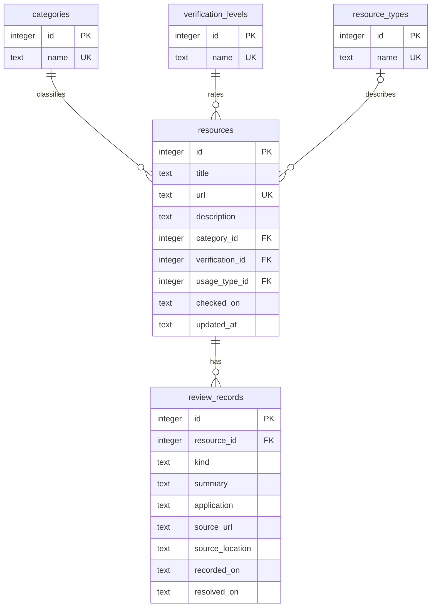

# OpenDB 오픈소스 자료 카탈로그

프로젝트에 활용할 오픈소스와 웹서비스를 찾고, 원문 근거와 적용 판단을 자료별로 축적하는 웹 응용시스템입니다. [AgentFlow Open](https://github.com/laadkke-arch/agentflow-open)의 조사 기록 원칙을 참고했습니다.

[공개 웹서비스](https://opendb-tlsee0813.onrender.com)

## 기능

- 자료명·출처 URL·활용 메모·검토 기록으로 검색하고, 분류·활용 유형·검증 수준을 조합해 결과를 좁힙니다.
- 최근 수정순·자료명순·최근 확인순으로 정렬하고, 현재 검색 결과 전체를 CSV로 내려받습니다.
- 상세 화면에서 출처와 확인일을 읽고, 이전 목록으로 돌아갈 때 검색 조건을 유지합니다.
- 자료를 추가하거나 수정하고, 연결된 기록 수를 확인한 뒤 삭제합니다.
- 자료별로 원문 근거·적용 제약·확인할 점을 남기고, 원문에서 확인한 내용과 프로젝트 적용 판단을 구분합니다.
- 검토 보드에서 미완료 질문, 최근 근거·제약, 자료 전체의 검증 수준을 확인합니다. 질문은 완료하거나 다시 열 수 있습니다.
- 주제 탐색에서 자동화, 협업, 검색과 문서, 서비스 운영, 품질과 검증, 시간·미디어·공간의 32개 주제를 둘러봅니다.
- 활용 가이드에서 한글 검색, 출처 및 파일 내보내기, CRUD·배포 검증, 변경 이력 실습을 확인합니다.
- 새 데이터베이스에 자료 124건과 공개 원문을 바탕으로 작성한 검토 기록 129건을 생성합니다.

## 로컬 실행

Python 3.12에서 실행합니다.

```sh
python -m venv .venv
source .venv/bin/activate
pip install -r requirements.txt
flask --app app run
```

[http://127.0.0.1:5000](http://127.0.0.1:5000)에 접속합니다. Turso 환경 변수가 비어 있으면 `instance/opendb.sqlite3`에 저장합니다. Windows PowerShell에서는 `.venv\Scripts\Activate.ps1`로 가상 환경을 활성화합니다.

## Turso Cloud 연결 및 Render 배포

1. [Turso](https://app.turso.tech/)에서 과제용 빈 **libSQL** DB를 만들고 URL과 읽기·쓰기 DB 토큰을 발급합니다.
2. Render에서 이 저장소의 `main`을 소스로 Python 웹서비스를 생성합니다. 빌드 명령은 `pip install -r requirements.txt`, 시작 명령은 `gunicorn --workers 1 --threads 4 --bind 0.0.0.0:$PORT 'app:create_app()'`입니다.
3. Render의 **Environment**에 다음 변수를 설정하고 배포합니다.

| 환경 변수 | 값 |
| --- | --- |
| `TURSO_DATABASE_URL` | Turso의 DB 연결 주소 |
| `TURSO_AUTH_TOKEN` | 해당 DB의 읽기·쓰기 토큰 |
| `FLASK_SECRET_KEY` | 세션 서명용 임의 값. 로컬에서 `python -c "import secrets; print(secrets.token_hex(32))"`로 생성 |
| `OPENDB_HOSTED` | `1` |
| `GUNICORN_CMD_ARGS` | `--access-logfile -` |

Gunicorn에서 미리 로드 옵션을 제외해 libSQL 원격 연결을 워커 프로세스에서 초기화합니다. 빈 DB에는 `db/schema.sql`과 `db/seed.sql`을 적용합니다. 이어서 `db/migrations/002_resource_types.sql`에서 활용 유형 테이블과 외래키를 추가하고 기본 자료에 유형을 배정합니다. `db/migrations/003_review_records.sql`에서 자료별 검토 기록과 예시를 추가합니다. `db/curated_catalog.json`은 문제별 학습 자료와 실습을 정의합니다. `db/topic_catalog.json`은 기존 과제 가이드와 별개로 32개 주제의 공개 원문 96건과 기록을 정의합니다. 갱신 시 이미 있는 URL을 건너뛰고, 주제별 최신 목록에 사용하는 인덱스를 같은 트랜잭션에서 추가합니다. 기존 DB에는 아직 적용하지 않은 변경만 실행합니다. `/healthz`가 HTTP 200과 `"database":"turso"`를 반환하면 앱이 Turso로 연결된 상태입니다. 두 DB 변수를 모두 생략해 Render에서 실행한 경우 SQLite 데이터는 인스턴스 교체 시 초기화될 수 있습니다.

## 데이터베이스 설계



자료마다 분류와 검증 수준은 필수이며 활용 유형은 선택입니다. 분류는 자료의 주제를 기록하고, 활용 유형은 프로젝트에서의 역할을 기록합니다. 유형은 대체 서비스, 개발 부품, 참고 자료 중 하나를 선택할 수 있습니다. 분류·검증 수준·활용 유형은 참조 중에 삭제할 수 없습니다. 자료와 검토 기록은 1:N 관계이며 자료를 삭제할 때는 연결된 검토 기록도 함께 삭제됩니다.

각 칼럼은 원자값을 저장하고 후보키는 단일 열입니다. 분류명, 검증 수준명, 활용 유형명은 각각의 참조 테이블에 저장하여 자료 행에서의 이행 종속을 제거했습니다. 동일한 자료 URL은 하나의 자료로 관리합니다. 검토 기록의 출처는 개별 관찰이 확인된 문서와 위치를 가리킵니다.

목록과 CSV는 동일한 검색 조건과 정렬을 사용합니다. 검토 기록 검색은 `EXISTS`를 사용해 하나의 자료에 여러 기록이 일치해도 목록에 한 번만 표시합니다. 목록 조회는 필수 참조 테이블을 `JOIN`하고, 유형이 미지정인 자료도 읽도록 `resource_types`를 `LEFT JOIN`합니다. 쓰기는 `INSERT`, `UPDATE`, `DELETE`와 `RETURNING id`를 사용합니다. 삭제 확인 폼은 POST로 처리합니다.

## 설계 참고

[AgentFlow Open의 데이터 모델 검토안](https://github.com/laadkke-arch/agentflow-open/blob/work/data-model/docs/product/DATA_MODEL_DRAFT.md)에서 자료와 검증 가능한 주장을 연결하는 구조를, [조사 프로토콜](https://github.com/laadkke-arch/agentflow-open/blob/work/data-model/docs/product/RESEARCH_PROTOCOL.md)에서 원문 위치와 확인 단계 기록 방식을 참고했습니다. OpenDB는 자료별로 여러 검토 기록을 두고, 기록에 확인한 내용·적용 판단·원문 주소와 위치를 입력하도록 적용했습니다.

한글 검색·파일 교환·검증·스키마 관리 자료는 관련 후보를 추린 뒤 공개 표준, 공식 매뉴얼, 공개 프로젝트 README를 다시 확인해 메모와 검토 기록을 작성했습니다. 새 자료에는 문서 확인 수준을 적용했습니다. 주제 탐색용 자료도 공식 표준·문서·공개 README를 다시 확인해 요약과 적용 판단을 작성했습니다.

## Codex 활용과 검증

Codex로 스키마, 자료 화면, 기록 작성과 검토 보드를 구현했습니다. 로컬 SQL 검사와 브라우저 검증으로 기존 자료 보존, 검색·CSV, 질문 완료·다시 열기, 자료 삭제 시 검토 기록 삭제를 확인했습니다. Render 배포 후에는 Turso 연결과 동일한 주요 사용자 흐름을 재검증할 수 있습니다.

로컬 회귀 테스트는 환경 변수를 등록하지 않은 가상 환경에서 실행합니다.

```sh
python -m unittest discover -s tests -v
```

## 공식 문서

- [Turso Python SDK 원격 연결](https://github.com/tursodatabase/turso-docs/blob/main/sdk/python/quickstart.mdx)
- [Render 웹서비스](https://render.com/docs/web-services)
- [SQLite 외래키](https://www.sqlite.org/foreignkeys.html)
