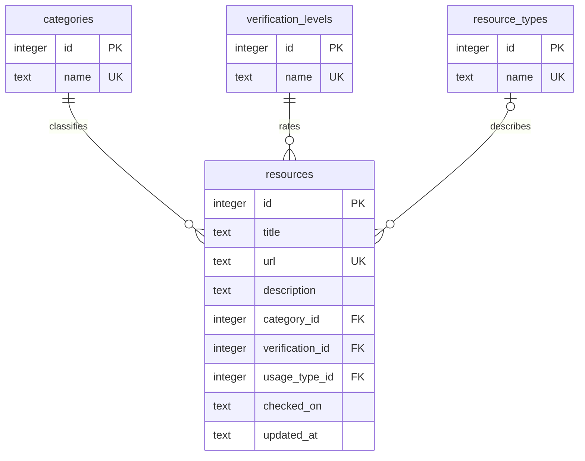

# OpenDB 오픈소스 자료 카탈로그

프로젝트에 활용할 오픈소스와 웹서비스의 출처, 분류, 검증 수준과 활용 메모를 관리하는 웹 응용시스템입니다. [agentflow-open](https://github.com/laadkke-arch/agentflow-open)의 조사 기록 원칙을 참고했습니다.

[공개 웹서비스](https://opendb-tlsee0813.onrender.com)

## 기능

- 자료명·출처 URL·활용 메모로 검색하고, 분류·활용 유형·검증 수준을 조합해 결과를 좁힙니다.
- 최근 수정순·자료명순·최근 확인순으로 정렬하고, 현재 검색 결과 전체를 CSV로 내려받습니다.
- 상세 화면에서 출처와 확인일을 읽고, 이전 목록으로 돌아갈 때 검색 조건을 유지합니다.
- 자료를 추가하고, 기존 자료를 수정하고, 확인 화면을 거쳐 삭제합니다.
- 새 데이터베이스에 자료 12건, 분류 4개, 활용 유형 3개, 검증 수준 3개를 생성합니다.

## 로컬 실행

Python 3.12에서 실행합니다.

```sh
python -m venv .venv
source .venv/bin/activate
pip install -r requirements.txt
flask --app app run
```

[http://127.0.0.1:5000](http://127.0.0.1:5000)에 접속합니다. Turso 환경 변수가 비어 있으면 `instance/opendb.sqlite3`에 저장합니다. Windows PowerShell에서는 `.venv\Scripts\Activate.ps1`로 가상 환경을 활성화합니다.

## Turso Cloud 연결 및 Render 배포

1. [Turso](https://app.turso.tech/)에서 과제용 빈 **libSQL** DB를 만들고 URL과 읽기·쓰기 DB 토큰을 발급합니다.
2. Render에서 이 저장소의 `main`을 소스로 Python 웹서비스를 생성합니다. 빌드 명령은 `pip install -r requirements.txt`, 시작 명령은 `gunicorn --workers 1 --threads 4 --bind 0.0.0.0:$PORT 'app:create_app()'`입니다.
3. Render의 **Environment**에 다음 변수를 설정하고 배포합니다.

| 환경 변수 | 값 |
| --- | --- |
| `TURSO_DATABASE_URL` | Turso의 DB 연결 주소 |
| `TURSO_AUTH_TOKEN` | 해당 DB의 읽기·쓰기 토큰 |
| `FLASK_SECRET_KEY` | 세션 서명용 임의 값. 로컬에서 `python -c "import secrets; print(secrets.token_hex(32))"`로 생성 |
| `OPENDB_HOSTED` | `1` |
| `GUNICORN_CMD_ARGS` | `--access-logfile -` |

Gunicorn에서 미리 로드 옵션을 제외해 libSQL 원격 연결을 워커 프로세스에서 초기화합니다. 빈 DB에는 `db/schema.sql`과 `db/seed.sql`을 적용합니다. 이어서 `db/migrations/002_resource_types.sql`에서 활용 유형 테이블과 외래키를 추가합니다. 기존 DB에는 이 변경만 적용하며 자료 ID와 기존 입력값은 유지합니다. 기본 샘플의 출처 URL로 활용 유형을 배정하고 그 외 자료는 미지정으로 둡니다. 이 작업은 트랜잭션으로 한 번만 실행됩니다. `/healthz`가 HTTP 200과 `"database":"turso"`를 반환하면 앱이 Turso로 연결된 상태입니다. 두 DB 변수를 모두 생략해 Render에서 실행한 경우 SQLite 데이터는 인스턴스 교체 시 초기화될 수 있습니다.

## 데이터베이스 설계



자료마다 분류와 검증 수준은 필수이며 활용 유형은 선택입니다. 분류는 자료의 주제를 기록하고, 활용 유형은 프로젝트에서의 역할을 기록합니다. 유형은 대체 서비스, 개발 부품, 참고 자료 중 하나를 선택할 수 있습니다. 참조 중인 부모 행의 삭제는 DB에서 제한합니다.

각 칼럼은 원자값을 저장하고 후보키는 단일 열입니다. 분류명, 검증 수준명, 활용 유형명은 각각의 참조 테이블에 저장하여 자료 행에서의 이행 종속을 제거했습니다. 동일한 출처 URL은 하나의 자료로 관리합니다.

목록과 CSV는 동일한 검색 조건과 정렬을 사용합니다. 목록 조회는 필수 참조 테이블을 `JOIN`하고, 유형이 미지정인 자료도 읽도록 `resource_types`를 `LEFT JOIN`합니다. 쓰기는 `INSERT`, `UPDATE`, `DELETE`와 `RETURNING id`를 사용합니다. 삭제 확인 폼은 POST로 처리합니다.

## Codex 활용과 검증

Codex로 스키마와 화면을 구현하고, 로컬 SQLite와 공개 Render 앱에서 CRUD를 검증했습니다. 기존 버전의 DB에 별도 자료를 넣은 상태에서 마이그레이션을 재현해 자료 보존 및 새 외래키 제약을 확인했습니다. 공개 앱에서는 실제 Turso 연결, 조합 검색, 정렬, 필터를 유지한 상세 화면 이동과 CSV 다운로드를 검증했습니다.

## 참고 자료

- [Turso Python SDK 원격 연결](https://github.com/tursodatabase/turso-docs/blob/main/sdk/python/quickstart.mdx)
- [Render 웹 서비스](https://render.com/docs/web-services)
